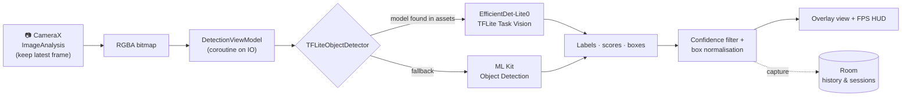

<div align="center">

# 👁️ VisionDetect AI

**Real-time, on-device object detection for Android — point the camera at the world and see what the AI recognizes.**


</div>

---

## 📌 Overview

**VisionDetect AI** runs a deep-learning object detector directly on the phone. Every camera frame is passed to a
TensorFlow Lite model, and the app draws a labelled bounding box with a confidence score around each object it finds —
people, laptops, cups, chairs and 76 more everyday categories. Everything happens **offline**: no image ever leaves
the device.

Beyond live detection, the app records each detection session, keeps a searchable history and turns the numbers into
charts, so you can see how fast the model runs and what it detects most often.

<!--
📸 SCREENSHOTS / DEMO — add them here, this is the most important part of the page for a vision app.
1. Record a short screen video of live detection and convert it to a GIF (e.g. with ezgif.com), or take screenshots.
2. Put them in a folder named  screenshots/  in this repository.
3. Delete this comment block and uncomment the table below.

| Home | Live detection | Analytics | History |
|:-:|:-:|:-:|:-:|
|  |  |  |  |
-->

## ✨ Features

| | Feature | Details |
|:-:|:--|:--|
| 🎯 | **Live object detection** | CameraX streams frames to the detector; boxes, labels and confidence are drawn on a custom overlay view |
| 🧠 | **Dual AI engine** | EfficientDet-Lite0 (TensorFlow Lite Task Vision, 80 COCO classes) as the primary model, with ML Kit Object Detection as an automatic fallback |
| ⏱️ | **Performance HUD** | Live FPS and per-frame inference time; frames are skipped while the previous one is still being processed |
| 🎚️ | **Adjustable confidence** | A slider sets the minimum confidence (10–95 %); labels and boxes can be toggled on or off |
| 📸 | **Capture & pause** | Freeze the stream, or save the current detections to history with one tap |
| 🗂️ | **Detection history** | Every capture is stored in Room — searchable by object name, with delete and clear-all |
| 📊 | **Analytics dashboard** | MPAndroidChart pie chart of detected objects, bar chart of inference times and line chart of FPS per session |
| 🌗 | **Dark / light mode** | Theme switch saved with DataStore Preferences |
| 📖 | **About AI** | An in-app explanation of how the detection pipeline works |

## 🧠 How detection works



1. CameraX delivers frames with the **keep-only-latest** back-pressure strategy, so the camera never queues up stale frames.
2. The ViewModel skips a frame if inference on the previous one is still running, which keeps the UI smooth.
3. The detector tries the bundled **EfficientDet-Lite0** model first (4 threads, up to 10 results).
   If it cannot load, it switches to **ML Kit** in stream mode.
4. Results below the user's confidence threshold are dropped, and box coordinates are normalised to the preview size.
5. When a session ends, its frame count, average FPS, average inference time and most-detected object are saved.

## 🏗️ Architecture

**Clean Architecture + MVVM**, with Hilt for dependency injection.

```
app/src/main/java/com/visiondetect/ai/
├── ai/engine/          # TFLiteObjectDetector — TFLite + ML Kit dual engine
├── core/utils/         # FPS calculator
├── data/
│   ├── local/          # Room database, entities, DAOs
│   └── repository/     # repository implementations, DataStore settings
├── di/                 # Hilt modules
├── domain/
│   ├── model/          # DetectionResult, DetectionRecord, DetectionConfig, analytics models
│   ├── repository/     # repository interfaces
│   └── usecase/        # save / load / search / analytics use cases
└── presentation/       # Fragments + ViewModels: splash, home, detection, history, analytics, settings, about
```

| Layer | Responsibility |
|:--|:--|
| **Presentation** | Fragments with View Binding, ViewModels exposing `StateFlow`, Navigation Component + bottom navigation |
| **Domain** | Plain Kotlin models and use cases — no Android framework code |
| **Data** | Room for history and sessions, DataStore for settings, the AI engine for inference |

## 🧰 Tech stack

| Area | Technology |
|:--|:--|
| Language | Kotlin 2.0 |
| AI / ML | TensorFlow Lite Task Vision (EfficientDet-Lite0, SSD MobileNet v1 included), Google ML Kit Object Detection |
| Camera | CameraX (Preview + ImageAnalysis) |
| Architecture | Clean Architecture, MVVM, Use Cases |
| Dependency injection | Hilt |
| Async | Kotlin Coroutines, StateFlow |
| Storage | Room, DataStore Preferences |
| UI | Material Components, Navigation Component, custom overlay `View`, View Binding |
| Charts | MPAndroidChart |
| Logging | Timber |

## 🚀 Getting started

**Requirements:** a recent Android Studio with AGP 8.9 support, JDK 17, and a **physical Android device running
Android 10 (API 29) or newer** — the emulator camera is not good enough for real detection.

```bash
git clone https://github.com/Monira-Meem/VisionDetectAI.git
```

1. Open the `VisionDetectAI` folder in Android Studio and let Gradle sync.
2. Connect your phone with USB debugging enabled and press **Run ▶**.
3. Grant the camera permission, tap **Start Detection**, and point the camera at everyday objects.

The TensorFlow Lite models and the COCO label file are already included in `app/src/main/assets/`, so no extra
download is needed.

## 🛣️ Roadmap

- [ ] GPU delegate for faster inference on supported devices
- [ ] Save an image snapshot with each captured detection
- [ ] Custom model trained on my own dataset (transfer learning with TFLite Model Maker)
- [ ] Unit tests for use cases and ViewModels

## 🙏 Acknowledgements

- [TensorFlow Lite](https://www.tensorflow.org/lite) and the EfficientDet-Lite / SSD MobileNet models trained on the [COCO dataset](https://cocodataset.org/)
- [Google ML Kit](https://developers.google.com/ml-kit/vision/object-detection)
- [MPAndroidChart](https://github.com/PhilJay/MPAndroidChart)

---

<div align="center">

Made by **[Monira Meem](https://github.com/Monira-Meem)** · Final-year B.Sc. Computer Science & Technology, Wuhan Institute of Technology

</div>
